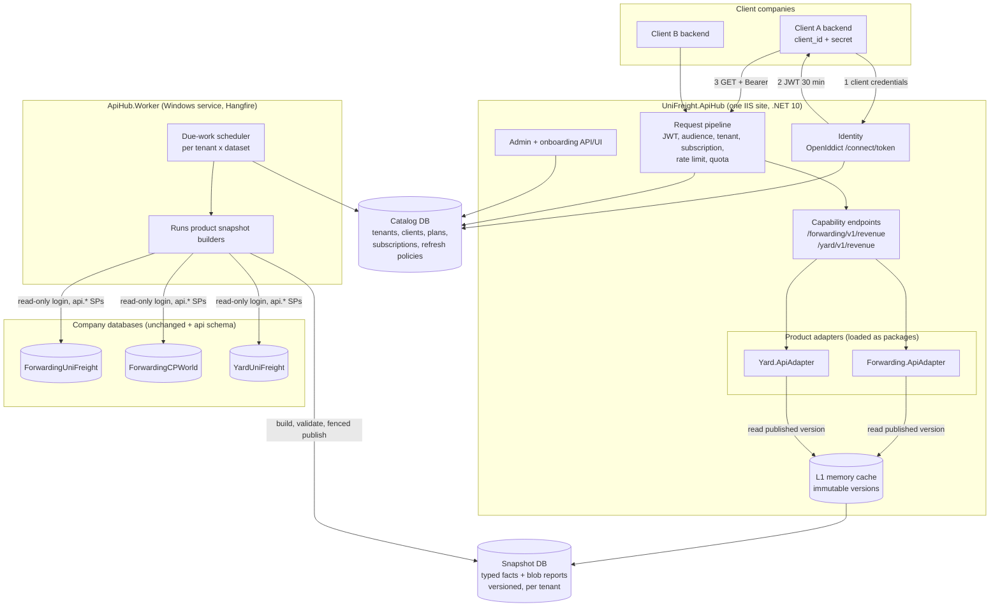
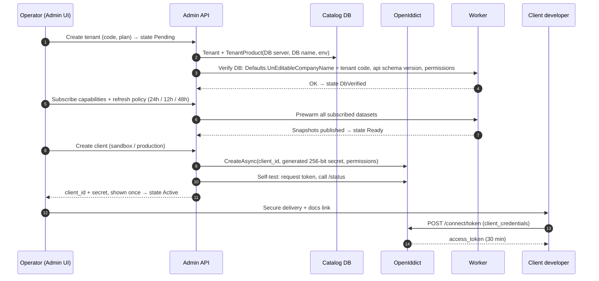
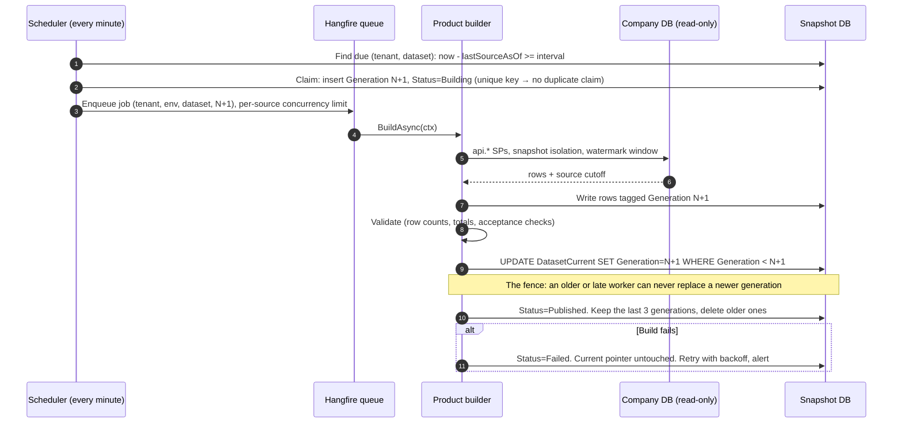
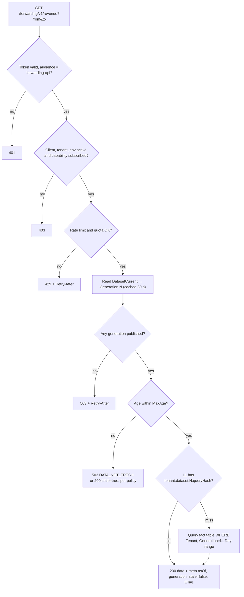

# Plan E: UniFreight API Hub (recommended)

**Prepared:** 21 October 2026
**Status:** Recommended architecture. Design only, no code changed.
**Inputs:** the four plans in `D:\API PLANS\`, a read of `ForwardingUniFreight.Solution`, and a debate with Codex (GPT-6.1-Sol, ultra effort) that challenged every point of the first draft.

---

## 1. The four existing plans, named and judged

| Name | File | Core idea | Verdict |
|---|---|---|---|
| **Plan A: Harden-in-Place** | `API_Integration_Plan.md` | Secure and document the existing 437 controllers inside the .NET 4.8 app, then migrate to .NET 10. Adds a snapshot read model. | **Don't use it for external clients.** The legacy API was built for its own jQuery screens: raw `pWhereClause` SQL, JSON inside strings, one database fixed at startup. Hardening it is still needed, but as a separate internal-security project. Its snapshot design is reused in Plan E. |
| **Plan B: Federated Products** | `API-PLATFORM-FULL-PLAN.md` | Central identity, gateway and refresh coordinator. Each product owns its API and SQL snapshots inside its own solution. Refresh interval per product. | **Right ownership model, wrong host.** Adding a bearer-token API inside the 4.8 app means bolting OWIN/JWT onto System.Web, and the app still can't switch database per request. Per-product refresh doesn't meet your per-client requirement. |
| **Plan C: DataHub Central** | `DataHub-Architecture-Plan.md` | One central API reaches every tenant database, caches raw JSON in FusionCache + Redis, refreshes per tenant and dataset. | **Best caching ideas, wrong fit.** It was designed for foreign ERPs (Oracle, SAP, Odoo). Your products are your own. Raw "as-is" payloads can't be filtered by date range, and Redis is extra infrastructure on day one. |
| **Plan D: Integration Platform** | `UniFreight API Platform.md` | New .NET 10 solution: Gateway + Identity + Catalog + `Forwarding.Api`. The tenant comes from the token, and each company database gets an `api` schema of parameterized stored procedures. | **Best foundation.** Strong on tenancy, auth and the `api` schema. Missing: caching, refresh schedules, subscriptions per capability, and the shared-contract pattern. |

**Plan E = Plan D's foundation + Plan B's ownership rule + Plan A/C's snapshot caching + per-client refresh.**

---

## 2. Debate with Codex: what changed

| # | Topic | My draft | Codex verdict | Final decision |
|---|---|---|---|---|
| 1 | Where the API lives | New central platform solution with a module per product | Agree with change: "central hosting must not become central ownership". Product-owned modern sidecars beside legacy are possible. | **Platform owns the plumbing; each product owns its adapter project in its own solution** (section 3). |
| 2 | Hosting | One ASP.NET Core host + one worker, no YARP yet | Agree. Give source-database credentials to the worker only. | Adopted, including **"API host never holds company-DB credentials for cached datasets"**. |
| 3 | Shared business | Ports & Adapters + Strategy, keyed DI | Agree with change: make semantics executable through shared acceptance examples. Unsupported → 404, unsubscribed → 403, misconfigured → fail at startup. | Adopted. |
| 4 | Auth | OAuth2 client credentials, JWT | Agree with change: check audience per product route even in one host. Check client, tenant, environment and endpoint grant. Define revocation delay. | Adopted. |
| 5 | Onboarding | Admin API + UI, secret shown once | Agree with change: resumable, idempotent states. Verify database identity and snapshots before activation. Operator-driven rotation from day one. | Adopted. |
| 6 | Rate limits | Limiter per client_id | Agree with change: quotas belong to the **tenant subscription**, or a second client_id doubles the allowance. Atomic reservation. | Adopted. |
| 7 | Cache storage | Central SQL blob snapshots + HybridCache | Agree with change: `ParamsHash` doesn't bound cardinality. **Typed fact tables are the default for range queries.** Blobs only for fixed reports. | Adopted: two snapshot kinds (section 7). |
| 8 | Refresh per client | Tenant override over dataset default | Agree. Hangfire locks alone aren't enough: **fence the publish** so an old worker can't overwrite newer data. | Adopted with a generation number. |
| 9 | Read behaviour | 200 + asOf/stale, 503 if missing | Agree with change: enforce MaxAge, pin paging to a version, refresh request → 202. | Adopted. |

Codex also listed things missing from all plans: source consistency (replica lag, late corrections, honest watermarks), versioned stored-procedure migrations across every company database, signing-key rotation and restore drills, and isolation and concurrency tests. They are in sections 9 and 10.

---

## 3. Where the API should live

You asked whether each solution should have its own API, or one solution should reach every database. The answer is **neither extreme**:

| Concern | Lives in | Why |
|---|---|---|
| Identity, client registration, subscriptions, rate limits, quotas, refresh scheduling, admin, docs portal | **One new platform solution** `UniFreight.ApiHub.sln` (.NET 10) | Same for every product. Written once. |
| Contracts (`IRevenueQuery`, DTOs, acceptance examples) | `UniFreight.ApiHub.Contracts` NuGet package | The shared language between platform and products. |
| Business implementation: how Forwarding calculates revenue, its SQL, its snapshot builder | **Inside each product's own solution** as a new .NET 10 class library, e.g. `Forwarding.ApiAdapter` in `ForwardingUniFreight.Solution.sln` | The team that knows the Forwarding schema owns it. It ships next to the `api` schema scripts it calls. |
| Hosting | The platform host loads each adapter package as a module (plugin) | One deployment to run. An adapter can later move to its own host without changing its code. |

The legacy `Forwarding.MvcApp` (.NET 4.8) is **not touched** and its `/api` routes are never published. The new adapter is a separate .NET 10 project in the same solution, so it doesn't depend on System.Web.



**Who can reach what:** only the Worker has logins to the company databases (read-only, `EXECUTE` on the `api` schema). The API host reads only the Catalog and Snapshot databases. A bug in a request handler therefore can't run a heavy query against a live company database.

---

## 4. Shared business, different implementation (the design pattern)

**Patterns:** Ports & Adapters (hexagonal) for the boundary, Strategy for the choice of implementation, Plugin for loading adapters, Template Method for snapshot builders.

```csharp
// UniFreight.ApiHub.Contracts: one port per business capability
public interface IRevenueQuery                       // read side, served from snapshots
{
    Task<RevenueResult> GetAsync(RevenueFilter filter, TenantScope scope, CancellationToken ct);
}

public interface ISnapshotBuilder                    // refresh side, run by the Worker only
{
    string DatasetCode { get; }                      // "forwarding.revenue.daily"
    int SchemaVersion { get; }
    Task<BuildResult> BuildAsync(BuildContext ctx, CancellationToken ct); // ctx: tenant, source conn, watermark, generation
}

// Each product registers its adapters under its product key
public sealed class ForwardingModule : IProductModule
{
    public string ProductCode => "forwarding";
    public void Register(IServiceCollection s)
    {
        s.AddKeyedScoped<IRevenueQuery, ForwardingRevenueQuery>(ProductCode);
        s.AddKeyedScoped<ISnapshotBuilder, ForwardingRevenueDailyBuilder>("forwarding.revenue.daily");
    }
}

// Platform maps the same capability once per product that registered it
app.MapCapability<IRevenueQuery>("revenue", "/{product}/v1/revenue")
   .RequireAuthorization("capability:revenue.read");
```

Rules:
- **Agree on the semantics before sharing code.** `revenue` = posted invoices, net of tax, credit notes subtracted, converted at the posting-date rate, grouped by local business date. These rules are written into `Contracts/AcceptanceExamples/*.json`, and every product adapter must pass them in CI.
- Product doesn't support it → **404**. Tenant not subscribed → **403**. A product that is subscribed but has no adapter registered → **the host refuses to start**.
- A product with genuinely different semantics (for example Yard counting storage revenue) gets a **separate capability** (`storage-revenue`), not a hidden variant.

---

## 5. Authentication and automated client onboarding

**Recommendation: OAuth 2.0 client credentials (OpenIddict), not raw API keys.**

| | API key | Client credentials → JWT (chosen) |
|---|---|---|
| Sent on every call | Long-lived secret | Short-lived token (30 min) |
| Leak impact | Valid until rotated | Expires in minutes |
| Scopes, audience per product | Custom work | Built in |
| Client tooling | Custom header | Every language's OAuth library, Swagger "Authorize" button |
| Server cost per call | Hash lookup | Signature check in memory |

Token claims: `sub`/`client_id`, `tenant_id`, `env`, `aud` (one product per token), `scope`. **Subscriptions are not in the token.** They are checked on every call against the cached Catalog (≤ 60 s), so a suspension takes effect within a minute. Audience is checked **per product route** even though all products share one host.

### Onboarding flow (automated, idempotent)



Every step records its state, so a failed onboarding resumes where it stopped. Secret rotation and revocation are operator actions from day one (two valid secrets during the switchover). A self-service portal for client admins comes later.

---

## 6. Subscriptions, rate limits and quotas

| Limit | Keyed by | Implementation |
|---|---|---|
| Burst (requests per second/minute) | `client_id` | ASP.NET Core `RateLimiter`, values from the plan. In-memory while there is one node. |
| Concurrency | `client_id` | Concurrency limiter, protects the host. |
| Commercial quota (per day/month) | **tenant + subscription** (all its clients together) | SQL `UsageLedger` with an atomic conditional `UPDATE ... WHERE Used + @n <= Limit`. Reset at midnight in the tenant's time zone. |
| Token endpoint | IP + client_id | Separate strict limiter and lockout. |

Counting rules are documented: `304 Not Modified` counts as 0.1 units, `429` and `5xx` count 0, refresh requests use a separate refresh budget. Add Redis only when you run several nodes **and** need exact shared limits.

Catalog tables: `Plans`, `Tenants`, `TenantProducts`, `ApiClients` (linked to the OpenIddict application), `Subscriptions(Tenant, Product, Capability, Env, From, To)`, `RefreshPolicies`, `UsageLedger`, `CatalogChangeLog`.

---

## 7. Caching: the decision

### Type: refresh-ahead snapshots in SQL, with an in-memory L1

| Option | Why not (alone) |
|---|---|
| Cache-aside (compute on miss) | The first caller after expiry waits for the heavy query and loads the live database. Rejected for heavy datasets. |
| Redis / FusionCache only | Memory-bound, needs extra infrastructure on-prem, and isn't durable enough for data that lives 48 hours. Doesn't solve modelling date ranges. |
| HTTP output cache | Same problem as cache-aside, plus it can't be shared safely across tenants without careful keys. |
| **Durable SQL snapshots, built on a schedule, with L1 memory on top (chosen)** | Heavy queries run only on the schedule. Data survives restarts and company-DB outages. Uses SQL Server, which you already run. Simple to inspect. |

**Why it is simple:** one Snapshot database, one generic publish mechanism, one scheduler. Each product decides only *what* to build.

**Why it is efficient:** reads hit indexed tables or a gzip blob, and are served from memory on repeat. The live company databases see one heavy query per dataset per refresh interval, however many API calls arrive.

### Two snapshot kinds: how each product gets its own cache structure

| Kind | Use for | Storage | Example |
|---|---|---|---|
| **Fact snapshot (default)** | Anything filtered by date range, customer, branch or currency | Typed table per dataset in the product's own schema of the Snapshot DB (`fwd.RevenueDaily`), keyed by `TenantCode, Generation` + dimensions, clustered index on `(TenantCode, Generation, Day)` | Revenue for any range = `SUM` over daily rows. A 2-year range = ~730 rows per currency. |
| **Document snapshot** | Fixed-shape reports returned whole | `core.SnapshotDocument(TenantCode, Dataset, PartitionKey, Generation, PayloadGzip, ETag)` | Open-shipments board, aging summary |

Arbitrary parameters are **never** a cache key. A product defines finite partitions (for example `month=2026-10`) or a daily grain. Non-additive metrics (distinct customers) get their own grain or become an async report.

Each product owns its schema in the Snapshot DB (`fwd.*`, `yard.*`) and its migrations. The platform owns `core.*`:

```sql
core.DatasetGeneration (TenantCode, Env, Dataset, Generation BIGINT, Status, SourceAsOfUtc, BuiltAtUtc, RowCount, Error)
core.DatasetCurrent    (TenantCode, Env, Dataset, Generation, PublishedAtUtc)  -- the pointer readers use
core.RefreshPolicy     (TenantCode NULL, Env, Dataset, IntervalMinutes, MaxAgeMinutes, PreferredWindowUtc, Enabled)
```

### Per-client refresh (24 h / 12 h / 2 days)

`RefreshPolicy` rows: a dataset default (`TenantCode = NULL`) plus tenant overrides. The plan caps the frequency (Basic ≥ 24 h, Premium ≥ 6 h), so freshness becomes something you can sell.

| Tenant | Dataset | Interval | Max age |
|---|---|---|---|
| (default) | forwarding.revenue.daily | 1440 min | 1560 min |
| UNF | forwarding.revenue.daily | 720 | 840 |
| CPW | forwarding.revenue.daily | 2880 | 3000 |

Because each company has its own database, "per client" means per tenant. Several apps of one tenant share the tenant's snapshots.

**Incremental builds:** fact builders rebuild only a watermark window (for example the last 45 days, which covers late postings and credit notes) and copy older partitions forward. A monthly full rebuild catches anything older.

### Refresh and fenced publish



### Read path



L1 entries are keyed by an **immutable generation**, so they never need invalidating: a new publish produces a new key, and old entries age out. Paging takes `?generation=N` so every page of one sync comes from the same version. An expired generation returns `410 Gone`. `POST /refresh` (premium plans) returns `202`, joins any build already running, and uses the refresh budget.

---

## 8. Solution structure

```
UniFreight.ApiHub.sln                         (new repo, .NET 10)
  src/
    ApiHub.Host/                 Identity (OpenIddict), pipeline, capability endpoints, Admin API, OpenAPI/Scalar
    ApiHub.Worker/               Windows service: scheduler + Hangfire server + builder runner
    ApiHub.Core/                 tenancy, subscriptions, quotas, snapshot publish/fence, L1, module loader
    ApiHub.Contracts/            → NuGet: IRevenueQuery, ISnapshotBuilder, DTOs, AcceptanceExamples/
    ApiHub.Persistence/          Catalog + core.* snapshot schema, migrations
  tests/                         isolation, fence, quota-concurrency, contract tests

ForwardingUniFreight.Solution.sln             (existing)
  Forwarding.MvcApp/             unchanged (.NET 4.8)
  Forwarding.ApiAdapter/         NEW .NET 10 library → NuGet: queries, builders, fwd.* migrations
  db/api-schema/                 api.* parameterized SPs, versioned, deployed to every company DB with DbUp

Yard.Solution.sln
  Yard.ApiAdapter/               same shape
```

---

## 9. Roadmap

| Phase | Weeks | Exit check |
|---|---|---|
| 0. Contract | 1–2 | Revenue semantics signed off. Acceptance examples with expected totals from real UNF data. |
| 1. Platform core | 3–5 | Host + OpenIddict + Catalog + onboarding states. A token for UNF can't read CPW (automated test). |
| 2. First adapter | 6–8 | `Forwarding.ApiAdapter`: `api.Revenue_Daily` SP, fact builder, fenced publish. Totals match the acceptance examples. |
| 3. Scheduler + policies | 9–10 | 12 h / 24 h / 48 h tenants refresh correctly. A late worker can't overwrite a newer generation (test). Restart recovery. |
| 4. Commercial | 11–12 | Plans, quotas per tenant, 429 behaviour, usage reports, docs portal + Postman. |
| 5. Pilot | 13–14 | One client in production, freshness and failure alerts, runbook, key-rotation drill. |
| 6. Second product | after | `Yard.ApiAdapter` plugs in with no platform code changed. |

---

## 10. Must-haves Codex added (no plan had all of them)

- **Source consistency:** build under SNAPSHOT isolation or from a replica, record the true source cutoff as `SourceAsOfUtc`, and rebuild a watermark window for late corrections.
- **Fleet migrations:** `api.*` SPs and the `fwd.*` snapshot schema are versioned. The Worker refuses a tenant whose `api` schema version is older than the adapter needs.
- **Tenant DB identity check:** before each build, compare `Defaults.UnEditableCompanyName` with the tenant code, so a mistyped server name can't serve CPW data as UNF.
- **Operations:** signing-key rotation with overlap, Snapshot DB backups and restore drills, alerts on refresh lag and failed builds.
- **Tests that prove it:** cross-tenant and cross-environment isolation, stale-worker publish, concurrent quota reservation, load on reads and refreshes.

## 11. Found in the code: act now, whatever plan you choose

- `Forwarding.MvcApp/Web.config:24` contains a **plain-text SQL login and password** for a public IP inside a comment. Rotate that password and remove the line, and remember it remains in TFS history.
- `Web.config:124-126`: `Access-Control-Allow-Origin: *`. Replace it with an allow-list.
